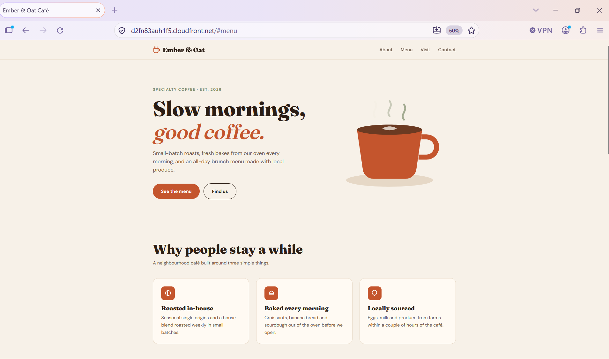
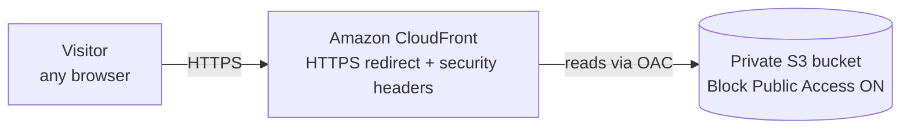
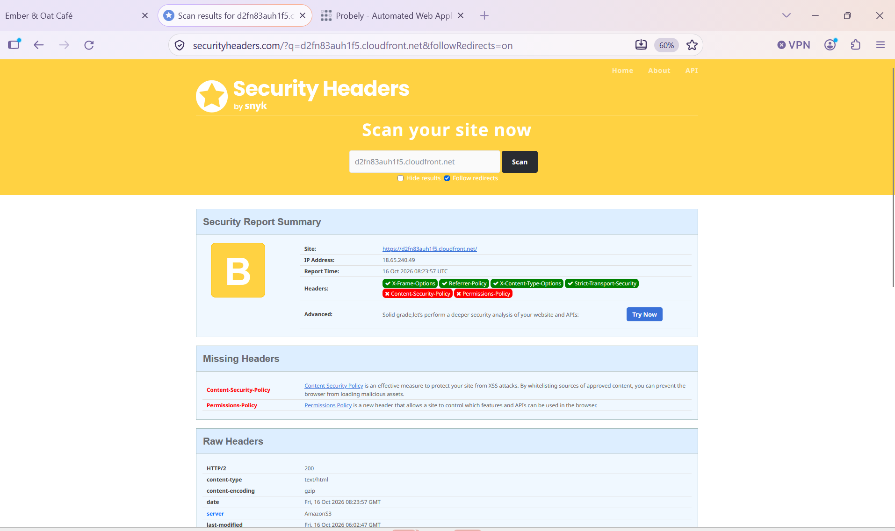
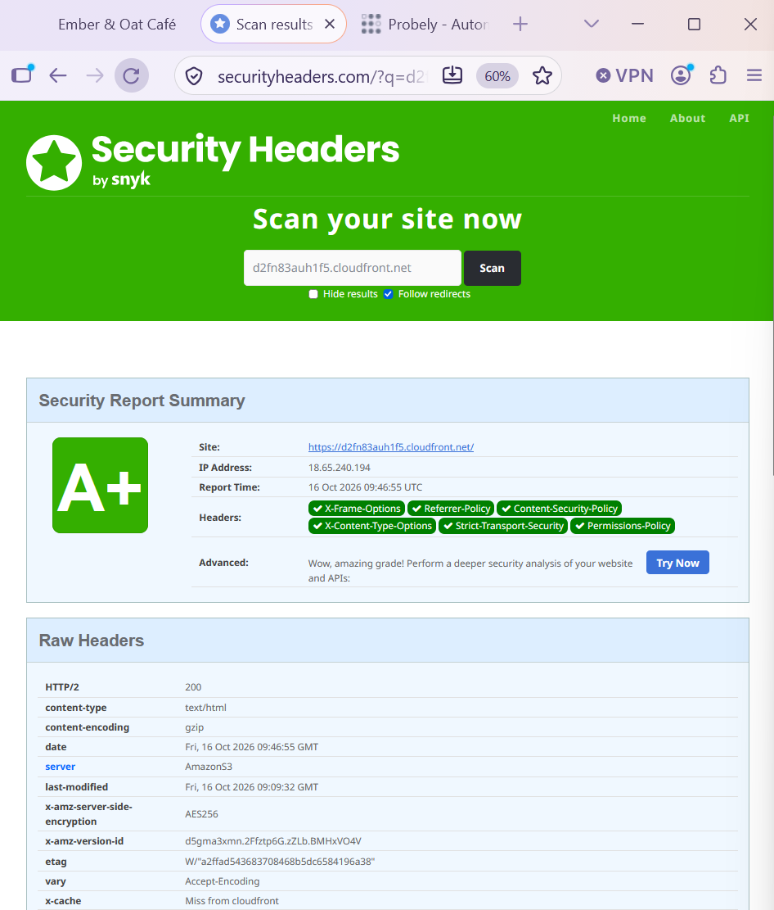
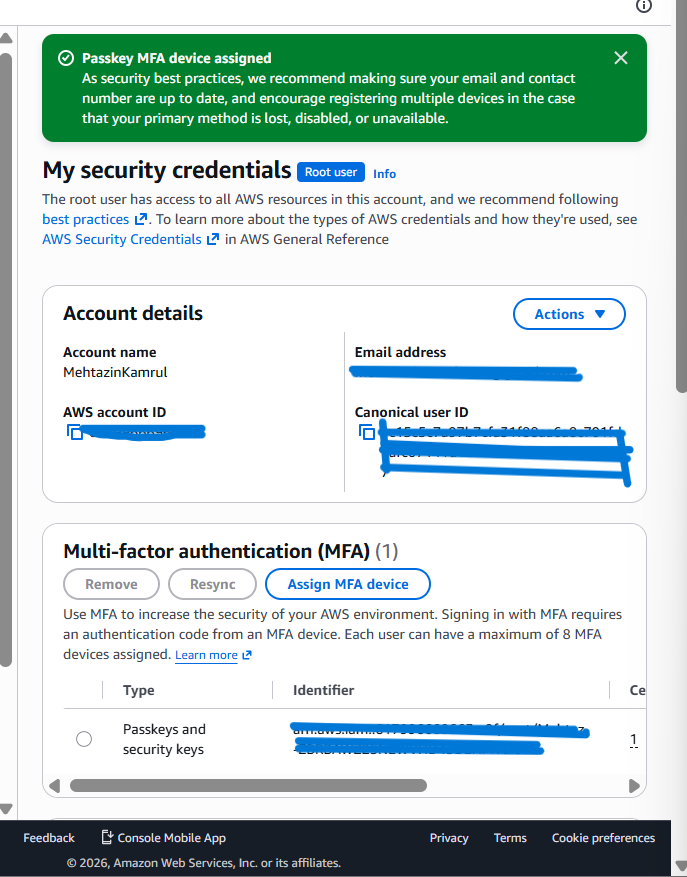
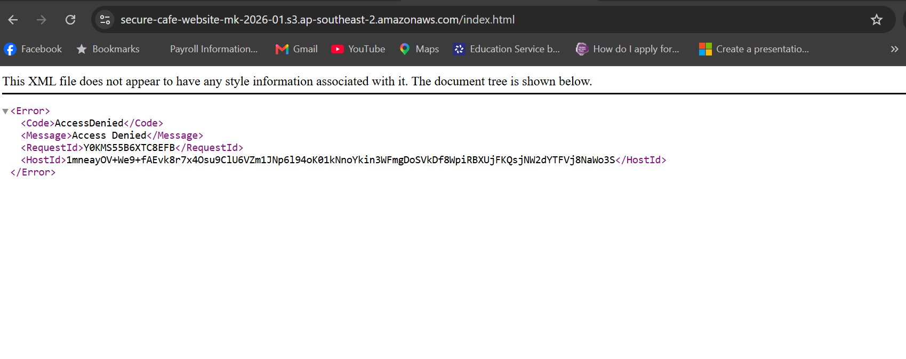
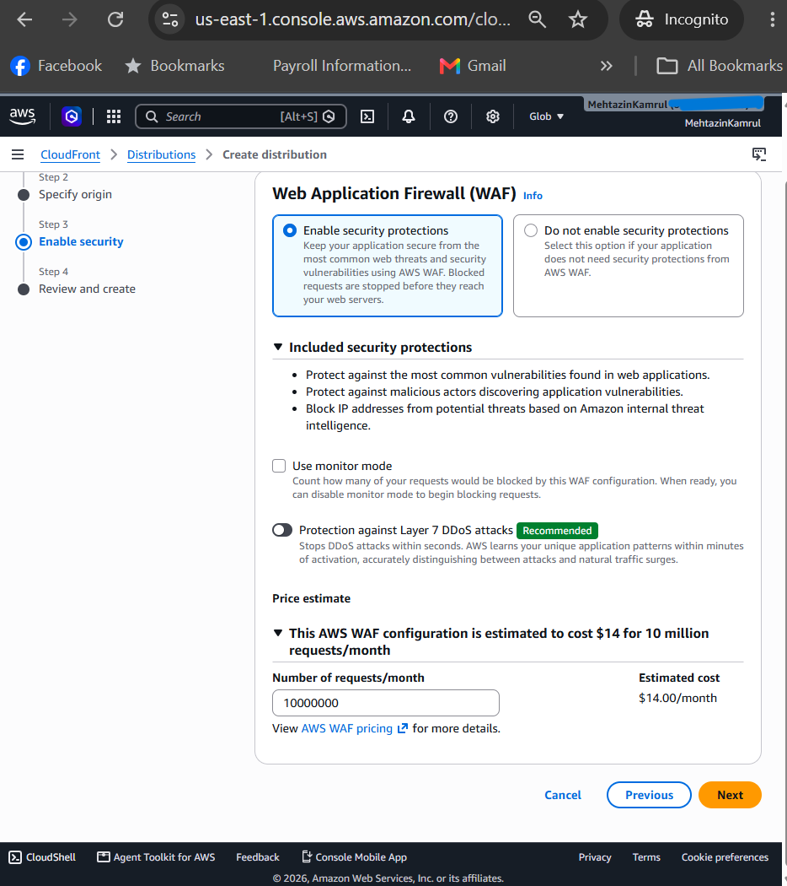
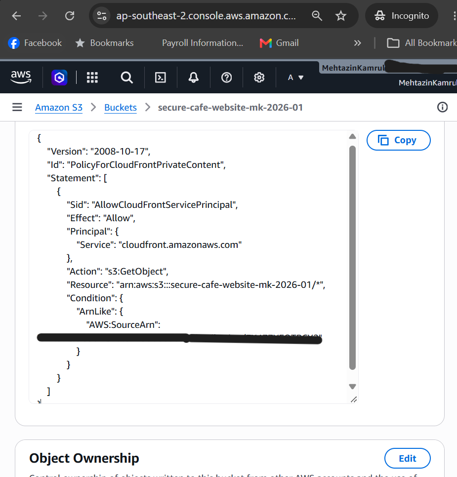
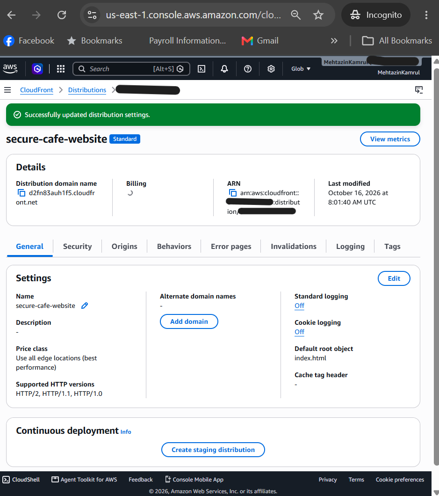
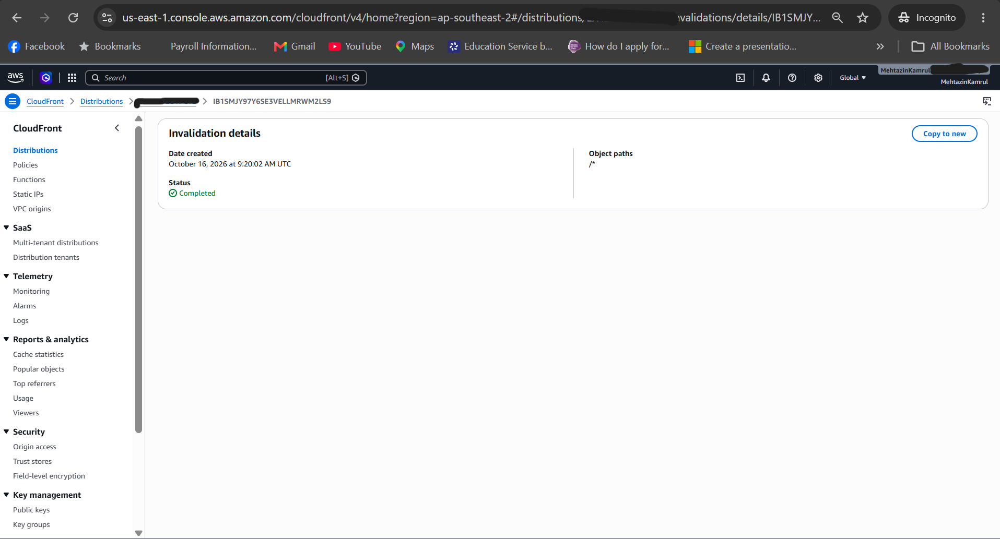

[README.md](https://github.com/user-attachments/files/33542356/README.md)
# Secure Café Website on AWS

A static café website hosted on AWS with a **private S3 bucket behind CloudFront**, served over **HTTPS only**, and hardened with security headers (**A+ on securityheaders.com**).

**Live site:** https://d2fn83auh1f5.cloudfront.net



---

## Overview

I built this project to practise deploying and securing a website the way it would be done in a real environment. The café ("Ember & Oat") is demo content; the focus is the cloud setup and the security decisions behind it.

## Architecture



- Visitors can only reach the site through CloudFront.
- The S3 bucket is private. Opening a file directly from S3 returns **AccessDenied**.
- CloudFront signs every request to S3 using **Origin Access Control (OAC)**, and the bucket policy only accepts requests from this one distribution.

## AWS services used

| Service | Purpose |
|---|---|
| Amazon S3 | Stores the website files (`index.html`, `script.js`) |
| Amazon CloudFront | Delivers the site worldwide over HTTPS, adds security headers |
| AWS IAM | Root account protected with passkey MFA |

## Security controls

| Control | What I did | Why |
|---|---|---|
| Private bucket | Block Public Access left ON | Nobody can bypass CloudFront and read S3 directly |
| Origin Access Control | CloudFront signs requests to S3 | Proves requests really come from my distribution |
| Least-privilege bucket policy | Only `s3:GetObject`, only for my distribution's ARN | CloudFront can read files but not change or delete them; other accounts' distributions are blocked |
| HTTPS only | Viewer protocol policy: Redirect HTTP to HTTPS | All traffic is encrypted |
| Security headers | Custom response headers policy (below) | Protects visitors' browsers from common web attacks |
| Encryption at rest | SSE-S3 on the bucket | Files are encrypted on disk |
| Versioning | Enabled on the bucket | Any overwritten or deleted file can be restored |
| Root MFA | Passkey MFA on the root user | Protects the account if the password leaks |

### Security headers (A+)

| Header | Value / purpose |
|---|---|
| Strict-Transport-Security | `max-age=31536000; includeSubDomains`: browser always uses HTTPS |
| Content-Security-Policy | Only allows scripts from this site; no inline scripts |
| X-Frame-Options | `DENY`: blocks clickjacking |
| X-Content-Type-Options | `nosniff`: stops the browser guessing file types |
| Referrer-Policy | `strict-origin-when-cross-origin`: limits data leaked to other sites |
| Permissions-Policy | Disables camera, microphone, geolocation and payment APIs |

Content-Security-Policy used:

```
default-src 'self'; script-src 'self'; style-src 'self' 'unsafe-inline' https://fonts.googleapis.com; font-src https://fonts.gstatic.com; img-src 'self' data:; frame-ancestors 'none'; base-uri 'self'; form-action 'self'
```

| Before (AWS managed policy) | After (custom policy + JS moved out of HTML) |
|---|---|
|  |  |

## How deployment works

1. Upload the files in `site/` to the S3 bucket.
2. Create a CloudFront invalidation for `/*` so visitors get the new version straight away instead of a cached copy.

## Problems I hit and how I fixed them

| Problem | Cause | Fix |
|---|---|---|
| `not authorized to perform cloudfront:CreateOriginAccessControl` and `cloudfront:CreateDistribution` | My university AWS Academy Learner Lab account blocks CloudFront | Created a personal AWS account on the Free plan, secured it with MFA, and rebuilt there |
| MFA setup failed: "Authentication code for device is not valid" | Authenticator app had a code from an old QR attempt | Restarted setup and switched to a passkey, which is also more phishing-resistant |
| CSP rejected: "must not have any leading or trailing whitespace" | Extra spaces copied into the header value | Cleared the field and pasted the value without spaces |
| Security headers stuck at **A** with a warning about `'unsafe-inline'` in `script-src` | JavaScript was written inside `index.html` | Moved all JavaScript into `script.js`, removed the inline `onclick`, and dropped `'unsafe-inline'` from `script-src`: **A+** |
| Site didn't show updated files straight away | CloudFront was serving cached copies | Created an invalidation for `/*` |

## Cost decisions

- **AWS WAF was considered but not enabled.** The console estimated about US$14/month, or US$35.50/month with Layer 7 DDoS protection. That's not justified for a small demo site. For a production business site I would enable it.
- Everything else runs within the AWS Free plan credits.

## Next steps

- [ ] Automate deployment with GitHub Actions using OIDC (no stored AWS keys)
- [ ] Define the infrastructure as code with CloudFormation or Terraform
- [ ] Add a custom domain with Route 53 and an ACM certificate
- [ ] Turn on CloudFront access logging
- [ ] Move the CSS into its own file so `'unsafe-inline'` can be removed from `style-src` too

## Screenshots

| Evidence | Screenshot |
|---|---|
| Root user protected with passkey MFA |  |
| Direct S3 access returns AccessDenied |  |
| WAF considered, not enabled due to cost |  |
| Bucket policy allows only my CloudFront distribution |  |
| Distribution settings: default root object `index.html` |  |
| Cache invalidation after an update |  |

## Repository structure

```
secure-cafe-website-aws/
├── site/
│   ├── index.html
│   └── script.js
├── screenshots/
└── README.md
```

---

Built by **Mehtazin Kamrul**, Bachelor of Cyber Security student, Griffith University.
